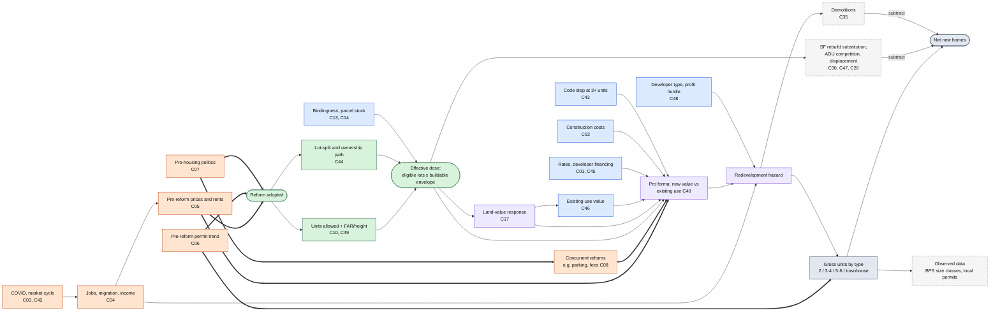
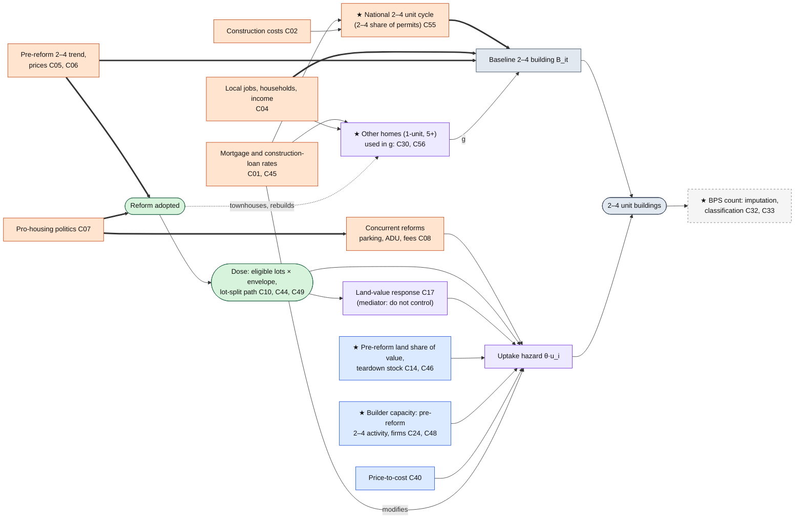

# Lotline: Causal diagram, Missing Middle (v0.1, 2026-10-04; v0.2 review 2026-11-03)

**Status:** working draft. §6 (v0.2) checks this diagram against the D-038 fit and lists what D-039 should test. This is the Missing Middle companion to `research/lotline-causal-diagram.md`, which holds the general framework and the ADU-focused diagram. Read that first; this file covers only what changes for 2–6 units on single-family lots.
**Register:** `research/lotline-confounder-register.csv`. Missing Middle uses 44 of the 56 factors. C43–C49 were added for this theme, and C55–C56 in the v0.2 review (§6).

---

## 0. What is different from ADUs

| | ADUs | Missing Middle |
|---|---|---|
| Who builds | The homeowner, usually living on site | Small developers and infill builders |
| What happens to the existing house | Kept | Usually demolished, so teardown economics decide (C46) |
| How rates bite | Homeowner equity, cash, HELOCs (C22) | Construction loans, cap rates, sale prices (C45) |
| Ownership | One parcel, one owner | Townhouses need their own lots; plexes need condo law or stay rental (C44) |
| Code | Residential code | 3+ attached units usually move to the commercial code: sprinklers, accessibility, licensed design (C43) |
| Biggest substitution | Garages, additions, informal units (C30, C31) | The single-family rebuild that would have gone on the same lot (C30), and ADUs on the same lot (C47) |
| What Census BPS sees | ADUs mostly invisible | Townhouses count as **1-unit** permits; 5–6 unit buildings are mixed into **5+** with large apartments |

The last row matters for measurement. Census BPS can see duplexes, and 3–4 unit buildings as a group. It cannot separate townhouses from detached houses, or 5–6 plexes from apartment blocks. Local permit data is needed for both.

---

## 1. Causal diagram

Thick arrows are back-door paths to block. Colors:

- **orange:** confounders
- **green:** the treatment and its dose
- **blue:** effect modifiers
- **purple:** mediators (never control for them)
- **grey dashed:** measurement and gross-to-net adjustments

A rendered copy is at `docs/research/lotline-causal-diagram-mm.png`.

**How it differs from the ADU diagram**

- **Land value pushes in both directions.** A reform raises what a lot is worth for redevelopment (helping feasibility). It also raises the price of the house a developer has to buy and tear down, which hurts feasibility. Auckland's evidence shows both: a higher redevelopment premium, and intensively built sites losing value (E003).
- **The code step (C43) sits between zoning and feasibility.** Allowing six units does little if a triplex costs much more per unit than a duplex.
- **Demolitions come out of the same hazard that produces new units.** Net gain per project is units built minus one (Portland: 1.68 → 3.88 units per demolition, E022).

---

## 2. Adjustment, bad controls and modifiers

The back-door paths and the bad-controls rule are the same as in the general diagram (§3 there).

**Additions for Missing Middle:**

- **Concurrent reforms are common and specific.** Code these as separate components with their own dates:
  - Durham's 2023 parking reform (SCAD), four years after Expanding Housing Choices;
  - Raleigh's Missing Middle 2.0 (2022), one year after TC-5-20;
  - Seattle's MHA upzoning alongside its 2019 ADU reform.
- **Don't control for post-reform teardown sales or house prices.** Both move because of the reform (C17, C46).

**Modifiers the Missing Middle model needs**, in order of how much they move results:

1. Price-to-cost regime (C40), on a **for-sale townhouse** pro forma and a **rental plex** pro forma separately.
2. Existing-use value relative to land value (C46).
3. Envelope actually buildable: units × FAR × height (C49), and whether the old rules bound (C13).
4. Code step at 3+ units (C43).
5. Developer financing: construction-loan rate and cap rate (C45).
6. Lot-split path (C44).

---

## 3. Identification: how to estimate a Missing Middle effect

Ranked strongest first, with the candidates we have:

| Design | Why it works | Candidates | Caveats |
|---|---|---|---|
| **Within-city eligible vs. ineligible lots** (triple difference) | Cancels everything citywide: rates, demand, politics | **Raleigh TC-5-20 (2021)**: two-family homes allowed everywhere except **R-1**, so R-1 lots are an in-city comparison group. **Durham EHC (2019)**: applied in the urban tier, so suburban-tier lots compare. Auckland (E001) and São Paulo (E006) as models. | R-1 lots are larger and on the edge, so match on lot size and value (C14). Spillovers onto nearby ineligible lots. |
| **Synthetic control** for a whole city | Matches the pre-reform path | Durham, Raleigh vs. NC and Southeast places; Lower Hutt (E004) as model | Few donors with clean histories; donors must be checked against the policy inventory (C27) |
| **Staggered DiD** across reforming cities | Uses timing differences | Oregon HB 2001 cities (E024); Durham 2019, Raleigh 2021, Charlotte 2023 | Few cities; Charlotte has ~2 years post-reform |
| **Dose-response** | Stronger rules should produce more | Minneapolis (FAR bound) vs Portland vs Spokane (E019, E022, E025) | Cross-city, so many other differences |

**Outcome scale:** net new units per 1,000 eligible lots per year, split by type. Townhouses and 5–6 plexes need local permits, not BPS.

---

## 4. Falsification checks specific to Missing Middle

| Check | Threat | Expected if the design is right |
|---|---|---|
| Single-family permits on **ineligible** lots before and after | Citywide shock (C04, C07) | No break at the reform date |
| Large apartment (20+ unit) permits | Citywide demand | No break at the reform date |
| Single-family rebuilds on **eligible** lots | Substitution (C30) | A fall is cannibalization; record it rather than treat it as noise |
| Triplex/fourplex share vs. duplex share | Code step (C43) | Response concentrated in duplexes and townhouses |
| Leads in event study | Selection, anticipation (C05, C29) | Flat |
| Permits on non-single-family land in the same city | Leakage (E016: Houston townhouses mostly on non-SF land) | Reported separately; not counted as reform effect |

---

## 5. Open questions

- Does North Carolina (or the chosen state) let small multifamily use the residential code? This decides C43 for the target.
- Can Raleigh and Durham permits separate townhouses from detached houses? If not, townhouses can be identified from parcel splits and year built.
- What FAR do we assume for the benchmark? The Handbook gives 3 stories and frees setbacks and coverage. A stated FAR sensitivity is the honest answer.

---

## 6. v0.2 review against the D-038 fit (2026-11-03)

**Why this section exists.** D-038 fitted one uptake rate on 15 places and left most of the difference between
places unexplained (place-effect variance α = 7.3). It also failed its placebo check: moving each adoption date
3 years earlier still found 0.32 per 1,000. Ben asked (2026-11-03) for the diagram to be checked against what the
fit controlled, before any new confounders are chosen. That covers land value, growth, and year-to-year interest
rates as a modifier. This section does that. It is written before any D-039 fit. The national figures below are
FRED series, not outcomes of any fit or test place.

### 6.1 Where a variable can enter

D-038's expected count for place *i* in year *t* is

    buildings_it = B_it + θ · u_i · eligible_i · dose_it · F(PCR_i)/F(1) · ramp(t − T_i)
    B_it        = pre-reform mean of 2–4 unit buildings × g_it (growth in the place's other homes)

A variable can do one of three jobs:

1. **Baseline (B).** It shapes what 2–4 unit building would have happened without the reform. Confounders
   belong here. Getting B wrong is what a failed placebo shows.
2. **Uptake (θ · u_i).** It shapes how strongly the reform bites. Effect modifiers belong here. Whatever the
   modifiers don't explain falls into u_i, the unexplained place effect, which is why α is 7.3.
3. **Count.** It shapes how the outcome is measured. Measurement problems belong here.

Two kinds of variable cost very different amounts of data:

- **Variables that change by year** (rates, the national 2–4 unit cycle, local growth) are estimated from
  year-to-year movement. That movement covers 2010–2025 in every place, adopters or not, so they are cheap to
  add to the baseline.
- **Variables that are fixed for a place** (land value, builder capacity, rule type) can only be learned from
  differences between adopting places. Only about 7 of the 15 places carry that information: 8 had zero 2–4
  unit buildings both before and after. So θ can take **one or two** such modifiers at most, chosen beforehand.

### 6.2 Revised diagram

Additions to §1 are marked ★. The changes are:

- the national 2–4 unit cycle, which carries rates (C55);
- the growth index as a possible bad control (C56);
- builder capacity and land share as modifiers of uptake;
- the BPS count as a measurement node.

Rates appear twice on purpose:

- **In the baseline.** Through the cycle, rates change how much 2–4 unit building happens anyway.
- **On the hazard.** Rates may change how many reform-enabled projects pencil.

The PNG beside this file still shows v0.1. The mermaid block above is the source for v0.2.

### 6.3 Audit: every factor that bears on the D-038 fit

The **Slot** column uses the three jobs from §6.1: B = baseline, θ = uptake, count = measurement. For data we
already hold, the **Our data** column names the dataset path under `LOTLINE_DATA_DIR`.

| # | Factor (register) | Slot | What D-038 did | Our data | What is wrong or missing | For D-039 |
|---|---|---|---|---|---|---|
| 1 | **National 2–4 unit cycle, including rates** (C01, C42, C45, new C55) | B; θ | Only through g (the place's other homes) | `raw/fred` MORTGAGE30US and PERMIT1/24/5NSA; `raw/census_bps_state_annual` (can drop our four states) | See the note under the table | **Top**, baseline |
| 2 | **Pre-reform trend and selection into reform** (C05, C06) | B | A flat pre-reform mean × g | BPS place history 2010–2025; `market_geo_year/fhfa` (tract to state) | The placebo failed. Places adopt while 2–4 unit building is already rising, and a flat mean misses that | **Top**, baseline (comparison places or a pre-trend) |
| 3 | **Local demand growth** (C04) | B | The place's own other homes (g) | `market_geo_year/demand` (Bartik index, place level, **2010–2023 only**); ACS households (`hh_growth` in the panel) | The Bartik index stops in 2023, before the 2024–25 years that carry the fit | High, baseline |
| 4 | **Growth index as a bad control** (C30, new C56) | B | g is built from post-reform 1-unit + 5+ permits | BPS | Lot-split reforms (Houston, Austin) make fee-simple townhouses that BPS counts as **1-unit**, and same-lot rebuilds can fall (C30). So g moves with the reform itself. The 5+ only check moved θ little (1.15 vs 1.08) | Medium: build g from comparison places, not the place itself |
| 5 | **Land value and teardown economics** (C14, C46; C17 is the mediator) | θ | Not in θ. `log_value` (ACS median home value) is in the panel but unused | Parcel land and building values: NC OneMap (2026) and Wake (2019, 2023); TX StratMap (2019, 2025) and TCAD (2026); MN MetC (2021–26). **OH parcels have no values** | Values must come from a **pre-reform** vintage, because post-reform values are partly the reform's effect (C17). NC OneMap is 2026 only, which is post-reform for every NC place; Ohio has none | **High**, θ (for example the share of eligible lots where land is ≥ half of value) |
| 6 | **Builder capacity and an existing infill industry** (C24, C48) | θ, ramp | None | `pre_permits` (2–4 unit homes per 1,000 eligible parcels before reform) is already in the panel. County Business Patterns: our pull has 2-digit NAICS only; residential builders (2361xx) need a new fetch | The likeliest reason Houston (+1,092 over baseline) and Lubbock (−166) differ at similar dose and price-to-cost | **High**, θ |
| 7 | **Rule design: lot-split path, envelope, by-right** (C10, C44, C49) | θ (dose) | dose and `p_by_right`; lot split is not coded on its own | Ordinance coding in the policy inventory | Houston and Austin are the only lot-size-cut reforms in the fit, so this cannot be told apart from "Houston and Austin" | Sensitivity only, not a fitted modifier |
| 8 | **Price-to-cost** (C40) | θ | F(PCR), with σ fixed by judgment | `pcr` in the panel | θ moves 0.81–2.71 with σ; the slope on PCR is assumed, not fitted | Medium: fit the PCR slope in place of a new modifier, or keep it |
| 9 | **Construction costs** (C02) | B; θ | None | FRED WPUIP2311001 (PPI) | National, and moves with rates over 2021–25 | Low: part of row 1 |
| 10 | **Concurrent reforms** (C08) | θ | The tags-dropped check gave 1.60 | Policy inventory; `adu_coded` | Austin's 2023 parking change and fee changes overlap the 2024 reforms; check them against the policy inventory | Medium: code dates, run as a check |
| 11 | **BPS measurement** (C32, C33) | count | Used BPS buildings as is | BPS `imputed`, `months_reported`. **No Houston permit file fetched** | Houston's 2–4 unit buildings jumped from about 373 a year to 821. A change in classification or reporting would move θ more than anything else here | **High**, a cheap check **before** any fit |
| 12 | Spillovers between places (C26) | B | None | BPS neighbours | Would bias toward zero; small for a statewide total | Low |
| 13 | Infrastructure, hazards, HOAs (C20, C38, C12) | θ | None | Little | No usable data at place level | Not for D-039 |
| 14 | Code step at 3+ units (C43) | θ | None | State codes | Constant within a state, so it is absorbed by the state | Not for D-039 |

**Note on row 1, the national 2–4 unit cycle.** These are FRED national figures:

| | 2014 | 2017–21 | 2022 | 2023 | 2024 | 2025 |
|---|---|---|---|---|---|---|
| 2–4 unit share of all permitted homes | 2.8% | 2.9–3.2% | 3.3% | 3.6% | 3.7% | 3.9% |
| 30-year mortgage rate | 4.2% | 3–4.5% | 5.3% | 6.8% | 6.7% | 6.6% |

- **The share rose as rates rose.** High rates cut 1-unit and 5+ building more than 2–4 unit building. The
  baseline scales 2–4 unit building by other homes (g), which assumes that share stays flat.
- **So the baseline is too low in 2024–25.** That is when the four largest places carry their exposure: Houston,
  Austin, Cincinnati and Lubbock, at a mean rate of 6.7%. For Houston, the 2–4 to other-homes ratio was 3.4%
  over 2021–23 and 3.9% over 2024–25, so the baseline is about 15% low: about 630 rather than 550. That alone
  does not explain 1,642, but it biases θ upward.
- **Rate regime and place are confounded.** Every large place is exposed only at about 6.7%. Wilson, Wake Forest
  and Morrisville are exposed mostly at 4.6%. Part of α is therefore the rate regime.
- **Consequence for D-039.** A separate rate modifier on θ cannot be identified with today's exposure. It should
  go into the baseline through the cycle, and into θ only as a stated assumption (the pro forma slider, C01).

### 6.4 What this means for D-039 (to pre-register; nothing fitted)

1. **A measurement check before any fit.** Fetch Houston's own permit records through the IO layer and check its
   2024–25 BPS 2–4 unit count (row 11). If the jump is a reporting or classification change, it must be fixed
   first.
2. **Baseline.** Replace "pre-reform mean × own other homes" with a baseline that varies by year and comes from
   **non-adopting places in the same state**. Their 2–4 unit buildings each year carry rates, the national 2–4
   shift, state cycles and costs (rows 1, 2, 3, 4, 9) without using any treated place's post-reform data.
   - Add a place-specific pre-reform trend as a check.
   - Rerun the placebo date: it should now give about zero.
   - The comparison places must be checked against the policy inventory (C27), since "uncoded" is not the same
     as "no reform".
3. **Uptake modifiers (at most two, chosen now).** Builder capacity (`pre_permits`) and the pre-reform land share
   of eligible lots (row 5).
   - Places without a pre-reform value vintage take the state's mean modifier, and that is reported.
   - The PCR slope stays at its judged value unless it replaces one of the two.
4. **The test of Ben's question.** The V4 leave-one-place-out backtest, with the same benchmarks.
   - **If the confounders matter:** the error should fall below the no-effect benchmark (0.234 per 1,000) and α
     should shrink.
   - **If neither happens:** that is the finding. With this data, a place's uptake cannot be predicted from these
     inputs, and the model should say which local data would be needed.
5. **Not fitted:** a rate × θ interaction (row 1), lot-split rule type (row 7), and items 12–14.

### 6.5 Houston check: is the 2024–25 jump a measurement change? (2026-11-03)

This was step 1 of §6.4.

- **Script:** `scripts/dev/houston_bps_check.py`, with output in `reports/mm-d038/houston_check.csv`.
- **Sources compared:** Census BPS for Houston (4835000) against the city's own monthly permit summary
  (`houston_permits_summary`, from data.houstontx.gov).
- Nothing was fitted.

**What the city's own counts show:**

- **The BPS count is real, not a Census artefact.**
  - The city's single-family permits track BPS 1-unit homes within 7% in every year 2012–2025, including
    2025: city 4,785 against BPS 4,774.
  - The city has no 2–4 unit class. Its multi-family count minus BPS's 3+ unit homes is a rough stand-in for
    duplex homes. It roughly lines up with BPS duplex homes:

    | | 2022 | 2023 | 2024 | 2025 |
    |---|---|---|---|---|
    | City multi-family minus BPS 3+ | 682 | 593 | 753 | 2,252 |
    | BPS duplex homes | 714 | 1,000 | 1,134 | 2,108 |

    Before 2022 the stand-in is too noisy to compare, because large apartment permits land in different years.
  - So there is no break in how Houston reports to Census at the 2024 reform date.
- **The 2025 fall in houses is in the city's data too, and comes on gradually.**
  - City single-family permits ran 400–700 a month in 2024. They eased below that in the first half of 2025,
    and fell to 290–340 from August 2025.
  - Over the same year, BPS duplex buildings doubled from 567 to 1,054.
  - Two readings remain open:
    - a real shift from detached houses to duplexes;
    - attached houses being filed as duplexes after mid-2025.
  - Only permit-level records can settle which. They are not on the city portal; this would need a records
    request.
- **The bigger problem is the treatment, not the count.** Our coding (`config/reforms/tx.csv`) records two
  things:
  - Houston's code already treated a building with up to two units as single-family before Livable Places (city
    FAQ, Ord. 2023-801 §42-1).
  - Livable Places (effective 2023-11-27) newly allowed 3–8 units.

  What happened to each building type:
  - **Duplex buildings** rose under rules that already allowed them: 67 (2017), 140 (2019), 255 (2021), 500
    (2023), 567 (2024), 1,054 (2025).
  - **3–4 unit buildings**, the type the reform newly allowed, were 19 in 2024 and 2 in 2025.

  So D-038's Houston "effect" is mostly a duplex trend the reform did not enable. D-038 adds a reform effect on
  top of each place's pre-reform level times its growth in other homes, and the placebo failure fits this.
- **What this means for D-039.** D-039 should define the outcome as the building types each reform newly allows,
  coded per place from the reform rows. For Houston that means 3–4 unit buildings, or 3–8 units where local data
  can see them.
  - This is the "reform design" row (row 7 of §6.3) acting on the outcome, not on θ.
  - Austin's HOME phase 1 (3 units) may raise the same question, if its SF-3 district already allowed duplexes.
    Our Austin rows don't say, so this needs checking in the ordinance before D-039.
  - Without Houston, D-038's exploratory fit was 0.57 per 1,000; without Houston and Austin, 0.24. These were
    exploratory only and are not a D-039 result.

Two data notes, now in the source's provenance:
- The city file repeats identical 2018 and 2019 totals, which looks like a copied year.
- Houston's eligible-parcel count is the ACS single-family fallback (quality "low").

### 6.6 Austin check: do post-HOME "two-family" counts hold ADUs? (2026-11-03)

Ben raised this after §6.5.

- **Script:** `scripts/dev/austin_permit_class_check.py`, with output in `reports/mm-d038/austin_check.csv`.
- **Sources:** the city's new-building permits by Census class (`austin_permits`), set beside BPS.
- Nothing was fitted.

**The counts:**

| Year | Houses (101) | ADUs (102) | Two-family (103) | ADU + two-family | BPS 2-unit buildings |
|---|---|---|---|---|---|
| 2019–22 (mean) | 3,481 | 343 | 124 | 467 | 111 |
| 2023 | 1,559 | 243 | 78 | 321 | 64 |
| 2024 | 1,781 | 90 | 101 | 191 | 72 |
| 2025 | 1,970 | 9 | 367 | 376 | 176 |

**What it shows:**

- **ADUs moved into the two-family class.**
  - HOME phase 1 (applications from 2024-02-05) removed the secondary-apartment use. The ADU class fell from
    about 340 a year to 90, then 9.
  - Two-family permits rose from about 100 to 367 in 2025.
  - ADU plus two-family together is no higher than before HOME: 376 in 2025, against 424–553 in 2018–22.
  - 149 of the 2025 permits carry the city's new "TWO UNIT RES" or "THREE UNIT RES" description. The adapter's
    docstring already said second and third homes are now filed as an R-101 house or an R-103 two-family permit.
- **Census follows the city's class.** BPS 2-unit buildings rose from 72 to 176 in 2025, the same step as
  two-family permits.
  - D-038's Austin excess (251 observed against 133 expected in 2024–25) therefore comes mostly from
    relabelled ADUs, not new missing-middle buildings.
  - Three-four unit permits, the type HOME newly allowed (3 units per lot), were 3 in 2024 and 7 in 2025.
- **The pre-reform series has its own break.** BPS shows 1–2 two-unit buildings a year in 2016–18, against
  134–213 city two-family permits. Austin's reporting to Census changed around 2016 and again in 2019, so
  Austin's BPS 2-unit baseline is unreliable before 2019.
- **What the old code allowed.** Our HOME phase 1 ordinance copy (manual/texas,
  `Austin_HOME_Phase1_Ord_20231207-001.pdf`) shows three things:
  - "Duplex Residential" and "Two-Family Residential" uses existed before HOME. Part 4 renames Two-Family to
    Two-Unit and adds base districts where both are allowed.
  - Part 8 repeals and replaces §25-2-773, the Duplex Residential Use section.
  - Part 7 deletes §25-2-555(D) of the SF-3 regulations.

  So some SF zoning already allowed duplexes. The struck table text in our scan does not show which districts.
  Reading the pre-HOME code (§25-2-491 table, §25-2-555) would settle it.

**What this means:**

- **For D-039.**
  - Measure Austin's outcome as 3–4 unit buildings, as for Houston (§6.5).
  - Or count city permits by description, where "TWO UNIT RES" is an ADU-type second home on an existing lot.
  - BPS 2-unit buildings cannot tell an ADU from a duplex in Austin after 2023.
- **For the ADU side (outside D-038, flagged as a follow-up).** Austin's ADU class stops in 2024, so ADUs counted
  from class 102 are undercounted from 2024. Any ADU fit or check that uses Austin's 2024–25 permits needs the
  description flag, not the class.
