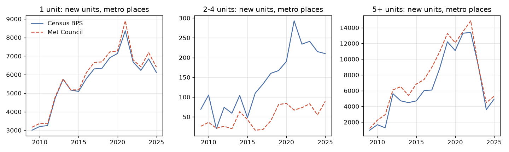

# Minnesota V0: do the MN adapters count what the publishers count?

Generated 2026-10-19 by `src/lotline/adapters/states/mn/v0_mn.py` from the processed MN tables. St. Paul
(2758000) appears through 2023 only (V5 holdout): its later rows are absent from every input.

## 1. Coverage and null rates by source

| source | rows | years | null units_new | null issue_date | null parcel_id | null units | null year_built | null lot_sqft | null land_value |
|---|---|---|---|---|---|---|---|---|---|
| metc_residential_permits | 114,363 | 2009-2025 | 0.0% | 100.0% | 61.9% |  |  |  |  |
| mpls_ccs_permits | 129,849 | 2016-2026 | 0.4% | 0.0% | 0.0% |  |  |  |  |
| stpaul_permits | 73,228 | 2015-2023 | 29.4% | 0.0% | 1.1% |  |  |  |  |
| metc_parcels | 6,576,148 | 2021-2026 |  |  |  | 63.5% | 10.9% | 5.2% | 0.4% |
| mpls_assessor_parcels | 1,309,636 | 2017-2026 |  |  |  | 16.5% | 7.1% | 0.3% | 0.0% |
| ramsey_parcels | 84,406 | 2026-2026 |  |  |  | 6.3% | 6.3% | 0.0% | 0.0% |

## 2. Met Council permits vs Census BPS (new construction, metro places, 2009 on)

Met Council `NU` (new units) rows by housing type against BPS units: SFD + TH vs 1-unit, DTQ vs 2-unit + 3-4
unit, MF5 vs 5+. City-years with fewer than 20 BPS units in a class are not judged.

| class | city_years | within_10pct | local_units | bps_units | ratio |
|---|---|---|---|---|---|
| 1 unit | 868 | 74% | 91,491 | 88,584 | 1.033 |
| 2-4 units | 33 | 9% | 415 | 1,131 | 0.367 |
| 5+ units | 400 | 64% | 110,462 | 111,338 | 0.992 |
| 1-4 units combined | 893 | 77% | 92,807 | 91,133 | 1.018 |

Ratio of Met Council to BPS units by year (all compared places):

| year | 1 unit | 2-4 units | 5+ units |
|---|---|---|---|
| 2009 | 1.054 | 0.377 | 1.234 |
| 2010 | 1.051 | 0.343 | 1.345 |
| 2011 | 1.03 | 1.05 | 2.303 |
| 2012 | 1.013 | 0.351 | 1.087 |
| 2013 | 1.004 | 0.339 | 1.381 |
| 2014 | 1.002 | 0.606 | 1.205 |
| 2015 | 1.016 | 0.896 | 1.455 |
| 2016 | 1.056 | 0.145 | 1.234 |
| 2017 | 1.055 | 0.135 | 1.476 |
| 2018 | 1.054 | 0.25 | 1.238 |
| 2019 | 1.045 | 0.485 | 1.088 |
| 2020 | 1.019 | 0.442 | 1.089 |
| 2021 | 1.064 | 0.229 | 1.015 |
| 2022 | 1.016 | 0.312 | 1.109 |
| 2023 | 1.031 | 0.344 | 0.992 |
| 2024 | 1.049 | 0.256 | 1.243 |
| 2025 | 1.047 | 0.424 | 1.074 |

20 largest metro cities, all years summed (ratio Met Council / BPS):

| city | 1 unit | 2-4 units | 5+ units |
|---|---|---|---|
| Apple Valley city | 1.06 | 0.2 | 1.19 |
| Blaine city | 1.09 | 0.09 | 1.41 |
| Bloomington city | 1.27 | 1.6 | 1.99 |
| Brooklyn Park city | 1.01 | 0.74 | 1.71 |
| Burnsville city | 1.05 | 0 | 1.04 |
| Coon Rapids city | 1.2 | 0 | 1.67 |
| Cottage Grove city | 1 | 0 | 1.15 |
| Eagan city | 0.97 | 0.76 | 12.12 |
| Eden Prairie city | 1.06 | 0.13 | 1.04 |
| Edina city | 1 | 0.32 | 1.4 |
| Lakeville city | 1.02 | 0.1 | 0.98 |
| Maple Grove city | 0.99 | 0 | 1.09 |
| Maplewood city | 1.46 | 0 | 1.9 |
| Minneapolis city | 1.11 | 0.81 | 1.02 |
| Minnetonka city | 1.01 | 0.63 | 1.29 |
| Plymouth city | 0.99 |  | 1.37 |
| St. Louis Park city | 1.62 | 0 | 1.03 |
| St. Paul city | 1.2 | 0.84 | 0.91 |
| Shakopee city | 1.02 | 0.13 | 0.82 |
| Woodbury city | 1.01 | 0 | 1.03 |

Judged city-year cells more than 10% apart, by class: 1 unit: 229, 2-4 units: 30, 5+ units: 146.

## 3. Minneapolis: CCS permits vs Met Council

CCS new units on new-building permits (work type New; ADUs of any work type; repeated project totals counted
once, D-008; cancelled permits dropped) against Met Council's
Minneapolis rows. Ratio CCS / Met Council:

| year | 1 unit | 2-4 units | 5+ units | ADU |
|---|---|---|---|---|
| 2017 | 0.92 | 2.4 | 0.8 | 1.36 |
| 2018 | 0.84 | 1.48 | 0.88 | 2.67 |
| 2019 | 0.98 | 1 | 0.83 | 1.78 |
| 2020 | 0.85 | 1.14 | 0.92 | 2.6 |
| 2021 | 0.59 | 1.23 | 0.9 | 2.29 |
| 2022 | 0.34 | 1.21 | 0.96 | 1.42 |
| 2023 | 1.01 | 1.1 | 0.98 | 1.75 |
| 2024 | 0.95 | 0.72 | 1.01 | 1.45 |
| 2025 | 0.8 | 1.24 | 0.91 | 1 |

Units:

| year | size_class | ccs | metc | ratio |
|---|---|---|---|---|
| 2017 | 1 unit | 134 | 145 | 0.92 |
| 2018 | 1 unit | 141 | 167 | 0.84 |
| 2019 | 1 unit | 124 | 127 | 0.98 |
| 2020 | 1 unit | 74 | 87 | 0.85 |
| 2021 | 1 unit | 64 | 108 | 0.59 |
| 2022 | 1 unit | 55 | 164 | 0.34 |
| 2023 | 1 unit | 74 | 73 | 1.01 |
| 2024 | 1 unit | 60 | 63 | 0.95 |
| 2025 | 1 unit | 57 | 71 | 0.8 |
| 2017 | 2-4 units | 24 | 10 | 2.4 |
| 2018 | 2-4 units | 49 | 33 | 1.48 |
| 2019 | 2-4 units | 47 | 47 | 1 |
| 2020 | 2-4 units | 50 | 44 | 1.14 |
| 2021 | 2-4 units | 48 | 39 | 1.23 |
| 2022 | 2-4 units | 52 | 43 | 1.21 |
| 2023 | 2-4 units | 69 | 63 | 1.1 |
| 2024 | 2-4 units | 26 | 36 | 0.72 |
| 2025 | 2-4 units | 57 | 46 | 1.24 |
| 2017 | 5+ units | 1,673 | 2,098 | 0.8 |
| 2018 | 5+ units | 3,175 | 3,607 | 0.88 |
| 2019 | 5+ units | 3,894 | 4,705 | 0.83 |
| 2020 | 5+ units | 2,895 | 3,144 | 0.92 |
| 2021 | 5+ units | 2,763 | 3,055 | 0.9 |
| 2022 | 5+ units | 3,682 | 3,816 | 0.96 |
| 2023 | 5+ units | 1,414 | 1,441 | 0.98 |
| 2024 | 5+ units | 550 | 542 | 1.01 |
| 2025 | 5+ units | 308 | 337 | 0.91 |
| 2017 | ADU | 30 | 22 | 1.36 |
| 2018 | ADU | 24 | 9 | 2.67 |
| 2019 | ADU | 32 | 18 | 1.78 |
| 2020 | ADU | 26 | 10 | 2.6 |
| 2021 | ADU | 16 | 7 | 2.29 |
| 2022 | ADU | 17 | 12 | 1.42 |
| 2023 | ADU | 14 | 8 | 1.75 |
| 2024 | ADU | 16 | 11 | 1.45 |
| 2025 | ADU | 13 | 13 | 1 |

## 4. ADUs vs published figures

ADU units by year:

| year | metc_metro | metc_minneapolis | ccs_minneapolis |
|---|---|---|---|
| 2014 | 1 | 0 | 0 |
| 2016 | 29 | 28 | 2 |
| 2017 | 27 | 22 | 30 |
| 2018 | 24 | 9 | 24 |
| 2019 | 30 | 18 | 32 |
| 2020 | 34 | 10 | 26 |
| 2021 | 27 | 7 | 16 |
| 2022 | 35 | 12 | 17 |
| 2023 | 38 | 8 | 14 |
| 2024 | 35 | 11 | 16 |
| 2025 | 52 | 13 | 13 |

| figure | years | published | met_council | ratio | ccs_inferred | source |
|---|---|---|---|---|---|---|
| ADUs permitted, 7-county metro | 2016-2024 | 300 | 279 | 0.93 |  | Star Tribune (citing Met Council), 'about 300' (docs/research/lotline-mn-scouting.md) |
| ADUs, Minneapolis, through 2022 | 2014-2022 | 232 | 106 | 0.46 | 147 | Twin Cities Business, 2023 (docs/research/lotline-mn-scouting.md) |

## 5. Recording-regime breaks (C32)

metc_metro: first 2014, jumps none; metc_minneapolis: first 2016, jumps [2018]; ccs_minneapolis: first 2016, jumps none

## 6. Gaps explained (validation plan §V0: every gap above 10% explained)

- **2-4 units (Met Council 0.37 × BPS) is most likely a filing difference, not missing homes.** Met Council
  appears to file many two-unit and twin-home buildings as SFD or TH, while the BPS files them as 2-unit
  buildings. With 1-4 units combined the two sources agree within 2% overall and within 10% in 77% of judged
  city-years.
- **1 unit (1.03 overall; 26% of judged city-years more than 10% apart).** Two thirds of those cells have
  more Met Council units than BPS. Likely causes: the survey year vs the BPS month of issue (projects
  straddle years), townhouse units counted differently by some BPS reporters, and BPS imputation: about 10%
  of the far-apart cells are places the BPS imputed or that reported fewer than 12 months (5% of all judged
  cells).
- **5+ units (0.99 overall; 36% of judged city-years apart).** Large projects are lumpy and can be permitted
  in phases or in a different year in each source. Some places report no 5+ units to the BPS in years Met
  Council records projects (e.g. Eagan 2017, 2019, 2021-2022), so city-year 5+ outcomes should use Met
  Council.
- **Minneapolis, 1 unit 2021-2022 (CCS 0.59 and 0.34 × Met Council).** Met Council counts 44 and 109
  townhouse units those years that have no matching TH-typed new permits in CCS (likely issued under a
  multifamily occupancy, which this comparison files as 5+; to verify by parcel). 2-4 units: CCS counts each
  permit's own units, Met Council files some duplexes as SFD/TH.
- **ADUs.** The metro count (279 for 2016-2024) is 0.93 × the published "about 300", within the rounding of
  the published figure. Minneapolis is far below the published 232 through 2022: Met Council has 106 and the
  CCS inference 147. The published figure likely counts ADU approvals including legalized existing units,
  while both our sources count ADU permits only. Use local ADU counts as a lower bound.
- **Recording break (C32).** Met Council has one ADU in 2014 and none in 2015, although Minneapolis
  legalized ADUs in December 2014: ADU recording starts in 2016. Pre-2016 ADU outcomes are unusable for the
  staggered design; Minneapolis's 2018 dip (9 vs 22 the year before) is in Met Council only, not in the
  city's permits.
