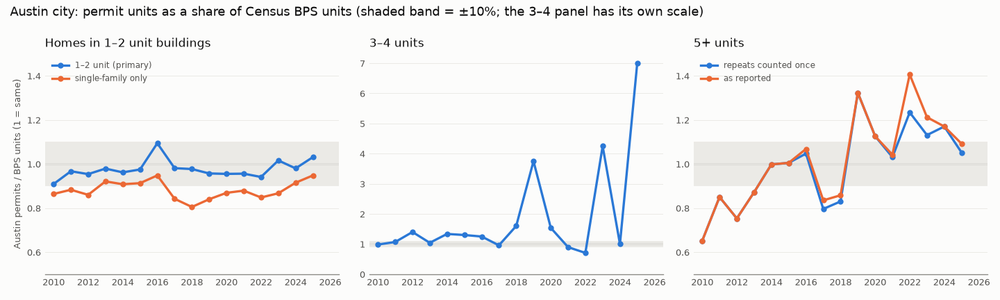

# V0 data check: Austin, Texas

<!-- GENERATED by `uv run python -m lotline.adapters.states.tx.v0_austin`. Do not edit. -->

- **Generated:** 2026-10-19 · `austin_permits` adapter v1.1
- **Data:** as pulled into `LOTLINE_DATA_DIR`; sources and dates in `docs/data_provenance.md`. BPS for Austin city (place 4805000) is the Census place file with imputation.
- **Held-out years:** none (Texas has no holdouts)
- **Headline:** homes in 1–2 unit buildings, Austin permits / BPS = **0.98** over 2010–2025 (yearly 0.91–1.09); single-family only 0.88 (0.81–0.95); 5+ units 1.04 with repeated totals counted once (D-008), 1.08 as reported. R-102 matches the city's ADU dataset in 16 of 16 years. TCAD single-family + condo parcels = 0.95 of ACS detached homes (Travis County only).
- **Result *(rule: every local-vs-BPS gap above 10% explained; published city counts within 5%)*:** 1–2 unit homes **PASS** (16 of 16 years within 10%); R-102 vs the ADU dataset **PASS**; single-family only **EXPLAINED** (filing of ADUs and duplex sides); 3–4 and 5+ units **GAPS OPEN** (yearly ratios outside 10%, partly explained below)

Decisions applied (Ben, 2026-10-19): (1) the primary comparison is all homes in 1–2 unit buildings; single-family only is secondary; (2) repeated project totals are counted once (D-008: at least 3 permits on one parcel and year with the same count of 50+ units), and 5+ is shown with the rule on and off, with mixed use (R-106) as its own line; (3) the TCAD undercount against the ACS is a known gap until the Williamson and Hays rolls are added.

## 1. Austin permits vs BPS by building size

### 1a. Homes in 1–2 unit buildings (primary)

Austin: single-family (R-101) + ADU (R-102) + duplex (R-103) units. BPS: 1-unit + 2-unit units.

| year | sf | adu | duplex | austin | bps_1 | bps_2 | bps | ratio |
|---|---|---|---|---|---|---|---|---|
| 2010 | 1,437 | 17 | 60 | 1,514 | 1,664 | 2 | 1,666 | 0.909 |
| 2011 | 1,513 | 17 | 129 | 1,659 | 1,713 | 2 | 1,715 | 0.967 |
| 2012 | 2,183 | 25 | 223 | 2,431 | 2,539 | 8 | 2,547 | 0.954 |
| 2013 | 2,370 | 94 | 254 | 2,718 | 2,573 | 202 | 2,775 | 0.979 |
| 2014 | 2,542 | 134 | 230 | 2,906 | 2,800 | 222 | 3,022 | 0.962 |
| 2015 | 2,599 | 151 | 344 | 3,094 | 2,846 | 326 | 3,172 | 0.975 |
| 2016 | 3,513 | 234 | 308 | 4,055 | 3,705 | 2 | 3,707 | 1.094 |
| 2017 | 3,737 | 357 | 267 | 4,361 | 4,440 | 4 | 4,444 | 0.981 |
| 2018 | 3,567 | 340 | 425 | 4,332 | 4,433 | 2 | 4,435 | 0.977 |
| 2019 | 3,838 | 375 | 346 | 4,559 | 4,568 | 196 | 4,764 | 0.957 |
| 2020 | 3,574 | 330 | 213 | 4,117 | 4,113 | 200 | 4,313 | 0.955 |
| 2021 | 3,675 | 341 | 236 | 4,252 | 4,180 | 268 | 4,448 | 0.956 |
| 2022 | 2,835 | 325 | 197 | 3,357 | 3,344 | 222 | 3,566 | 0.941 |
| 2023 | 1,559 | 243 | 156 | 1,958 | 1,799 | 128 | 1,927 | 1.016 |
| 2024 | 1,781 | 90 | 178 | 2,049 | 1,946 | 144 | 2,090 | 0.98 |
| 2025 | 1,970 | 9 | 527 | 2,506 | 2,079 | 352 | 2,431 | 1.031 |

Years outside ±10%: none.

Pooled 0.98; three-year pooled ratios stay between 0.95 and 1.02. The remaining shortfall (about 2%) is not attributed yet. Candidate causes, not tested: the city file assigns permits by today's city limits, while the BPS place series follows the reporting place each year; permits voided or cancelled after issue are dropped here but may stay in the BPS.

This line is comparable across HOME (December 2023): second and third homes moved from R-102 into R-101/R-103 permits, which stay inside the 1–2 unit total.

### 1b. Single-family only (secondary)

| year | sf_austin | sf_bps | sf_ratio |
|---|---|---|---|
| 2010 | 1,437 | 1,664 | 0.864 |
| 2011 | 1,513 | 1,713 | 0.883 |
| 2012 | 2,183 | 2,539 | 0.86 |
| 2013 | 2,370 | 2,573 | 0.921 |
| 2014 | 2,542 | 2,800 | 0.908 |
| 2015 | 2,599 | 2,846 | 0.913 |
| 2016 | 3,513 | 3,705 | 0.948 |
| 2017 | 3,737 | 4,440 | 0.842 |
| 2018 | 3,567 | 4,433 | 0.805 |
| 2019 | 3,838 | 4,568 | 0.84 |
| 2020 | 3,574 | 4,113 | 0.869 |
| 2021 | 3,675 | 4,180 | 0.879 |
| 2022 | 2,835 | 3,344 | 0.848 |
| 2023 | 1,559 | 1,799 | 0.867 |
| 2024 | 1,781 | 1,946 | 0.915 |
| 2025 | 1,970 | 2,079 | 0.948 |

Years outside ±10%: 2010, 2011, 2012, 2017, 2018, 2019, 2020, 2021, 2022, 2023. **Explained:** the BPS files most of Austin's ADUs and duplex sides as 1-unit homes. Over the period the BPS reports 2,280 units in 2-unit buildings, while the city file has 7,175 ADU and duplex units (duplexes are permitted one side at a time); adding them back gives the 1–2 unit line above, within 10% every year.

### 1c. 3–4 units

| year | 3_4_austin | 3_4_bps | 3_4_ratio |
|---|---|---|---|
| 2010 | 244 | 248 | 0.984 |
| 2011 | 47 | 44 | 1.068 |
| 2012 | 21 | 15 | 1.4 |
| 2013 | 175 | 168 | 1.042 |
| 2014 | 155 | 116 | 1.336 |
| 2015 | 39 | 30 | 1.3 |
| 2016 | 15 | 12 | 1.25 |
| 2017 | 69 | 72 | 0.958 |
| 2018 | 72 | 45 | 1.6 |
| 2019 | 60 | 16 | 3.75 |
| 2020 | 63 | 41 | 1.537 |
| 2021 | 35 | 39 | 0.897 |
| 2022 | 58 | 82 | 0.707 |
| 2023 | 51 | 12 | 4.25 |
| 2024 | 8 | 8 | 1 |
| 2025 | 21 | 3 | 7 |

Pooled 1.19 (1,133 units vs 951); years outside ±10%: 2012, 2014, 2015, 2016, 2018, 2019, 2020, 2021, 2022, 2023, 2025. **Open.** Counts are small (3 to 244 BPS units a year), so one 4-plex moves a yearly ratio by 10% or more, but the city side is higher in most years. Untested candidate: 3–4 unit townhome buildings the BPS files as 1-unit attached homes (that would also explain part of the 1–2 unit shortfall).

### 1d. 5+ units: repeated project totals counted once (D-008) and as reported

| year | rule on | as reported | mixed use (R-106) | bps_5p | ratio (rule on) | ratio (as reported) | ratio (rule on + mixed use) |
|---|---|---|---|---|---|---|---|
| 2010 | 561 | 561 | 24 | 860 | 0.652 | 0.652 | 0.68 |
| 2011 | 2,055 | 2,055 | 210 | 2,419 | 0.85 | 0.85 | 0.936 |
| 2012 | 5,762 | 5,762 | 1,246 | 7,648 | 0.753 | 0.753 | 0.916 |
| 2013 | 7,751 | 7,751 | 815 | 8,891 | 0.872 | 0.872 | 0.963 |
| 2014 | 6,289 | 6,289 | 1,158 | 6,304 | 0.998 | 0.998 | 1.181 |
| 2015 | 6,939 | 6,939 | 785 | 6,902 | 1.005 | 1.005 | 1.119 |
| 2016 | 5,426 | 5,534 | 91 | 5,184 | 1.047 | 1.068 | 1.064 |
| 2017 | 5,619 | 5,901 | 8 | 7,063 | 0.796 | 0.835 | 0.797 |
| 2018 | 7,304 | 7,554 | 47 | 8,803 | 0.83 | 0.858 | 0.835 |
| 2019 | 13,134 | 13,134 | 4 | 9,929 | 1.323 | 1.323 | 1.323 |
| 2020 | 15,017 | 15,017 | 386 | 13,336 | 1.126 | 1.126 | 1.155 |
| 2021 | 14,683 | 14,839 | 93 | 14,235 | 1.031 | 1.042 | 1.038 |
| 2022 | 18,255 | 20,810 | 232 | 14,798 | 1.234 | 1.406 | 1.249 |
| 2023 | 13,281 | 14,231 | 633 | 11,745 | 1.131 | 1.212 | 1.185 |
| 2024 | 8,594 | 8,594 | 1 | 7,346 | 1.17 | 1.17 | 1.17 |
| 2025 | 6,798 | 7,054 | 3 | 6,459 | 1.052 | 1.092 | 1.053 |

Pooled 2010–2025: 1.04 with the rule, 1.08 as reported; the rule removes 4,557 repeated units. Years outside ±10% with the rule: 2010, 2011, 2012, 2013, 2017, 2018, 2019, 2020, 2022, 2023, 2024.

| period | bps_5p | ratio (rule on) | ratio (as reported) | ratio (rule on + mixed use) |
|---|---|---|---|---|
| 2010–2013 | 19,818 | 0.814 | 0.814 | 0.93 |
| 2014–2018 | 34,256 | 0.922 | 0.94 | 0.983 |
| 2019–2023 | 64,043 | 1.161 | 1.218 | 1.182 |
| 2024–2025 | 13,805 | 1.115 | 1.134 | 1.115 |

**Partly explained, partly open:**

- *2010–2013, city below BPS:* adding mixed-use (R-106) dwellings closes most of it (last column), which suggests the BPS counts mixed-use apartments as 5+ in those years. Not confirmed.
- *2019–2025, city above BPS even pooled (2019–2023 1.16, 2024–2025 1.11):* repeated totals of 50+ units are already removed; repeated counts below the threshold remain (e.g. 2019: 9 permits on one parcel each reporting 36 units, 8 × 32, 7 × 36). They may be identical buildings or repeated totals; the threshold sensitivity (20–100 units, `config/params/permits.yaml`) is where to test it. Open.
- Yearly swings: a project's buildings can be permitted across a year boundary, so yearly ratios move in both directions; the period table is the better test.

## 2. R-102 (ADU) permits vs the city's ADU dataset

The city's ADU dataset (`687g-qcqy`, read 2026-10-18) is a view of R-102 permits. Both sides use the same filters (Austin full- and limited-purpose jurisdiction; void, withdrawn, aborted and cancelled permits dropped). Rule: within ±5% per year.

| year | r102_ours | adu_dataset | in_both | status |
|---|---|---|---|---|
| 2010 | 17 | 17 | 17 | match |
| 2011 | 17 | 17 | 17 | match |
| 2012 | 25 | 25 | 25 | match |
| 2013 | 94 | 94 | 94 | match |
| 2014 | 134 | 134 | 134 | match |
| 2015 | 151 | 151 | 151 | match |
| 2016 | 234 | 234 | 234 | match |
| 2017 | 357 | 357 | 357 | match |
| 2018 | 340 | 340 | 340 | match |
| 2019 | 375 | 375 | 375 | match |
| 2020 | 330 | 330 | 330 | match |
| 2021 | 341 | 341 | 341 | match |
| 2022 | 325 | 325 | 325 | match |
| 2023 | 243 | 243 | 243 | match |
| 2024 | 90 | 90 | 90 | match |
| 2025 | 9 | 9 | 9 | match |

Every year within ±5%.

ADU counts break in 2024: HOME removed the secondary-apartment use, and second and third homes are now R-101/R-103 permits marked only by the description (`reform_flag_raw`). This is the C32 recording-regime break; ADU-only series stop at 2023.

## 3. Permits linked to the Travis CAD roll

New-home permits (demolitions excluded). `parcel_id` is '48453' + the Travis CAD geographic ID; since adapter v1.1 an ID that starts with a letter (a Williamson or Hays appraisal account, e.g. R654373) is kept as written, without a county prefix, so it no longer looks like a Travis ID.

| period | permits | no parcel ID | Travis CAD ID | in 2026 TCAD roll | Williamson/Hays account |
|---|---|---|---|---|---|
| 2010–2019 | 32,484 | 0.53% | 90.53% | 59.29% | 8.94% |
| 2020–2025 | 19,136 | 0.94% | 97.91% | 53.76% | 1.15% |
| 2026 (to date) | 2,006 | 0.15% | 99.60% | 60.62% | 0.25% |

Older permits link less often because parcels are split and renumbered after the permit (a new subdivision gets new IDs); the 2026 roll holds today's parcels only.

## 4. TCAD parcel stock vs ACS homes (Austin city)

TCAD 2026 certified roll (Travis County part of Austin only) against ACS 5-year B25024 for Austin city. One parcel is one home for single-family and condo parcels.

| TCAD | parcels | ACS | homes | ratio |
|---|---|---|---|---|
| Single-family parcels | 163,890 | 1-unit detached | 209,772 | 0.781 |
| Single-family + condo parcels | 199,836 | 1-unit detached | 209,772 | 0.953 |
| Single-family + condo parcels | 199,836 | 1-unit detached + attached | 234,455 | 0.852 |

Single-family + condo parcels are 0.95 of ACS detached homes. Known gap, accepted (decision 3): Austin's Williamson and Hays County parts are not in the TCAD roll, and condo parcels include attached and stacked units the ACS puts in other size classes. Closes when the Williamson and Hays rolls are added.

## 5. What later steps must handle

- Use the 1–2 unit line, not single-family alone, for any Austin series that crosses December 2023.
- Count 5+ units with D-008 on; show the as-reported count as the sensitivity.
- Treat R-106 mixed use separately from 5+ until a project-level check says how the BPS files it.
- Parcel-based denominators for Austin cover the Travis part only (about 95% of detached homes).
