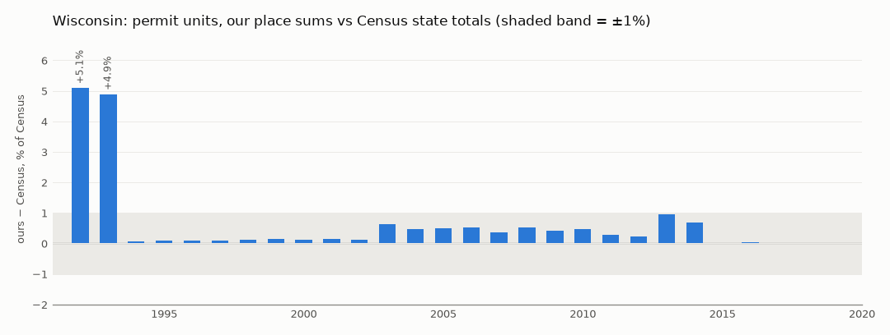

# V0 national data check: Wisconsin

<!-- GENERATED by `lotline validate --state WI --step V0`. Do not edit. -->

- **Generated:** 2026-11-19 · schemas 1.17
- **Data:** as pulled into `LOTLINE_DATA_DIR`; sources and dates in `docs/data_provenance.md`
- **Held-out years not compared:** 2020, 2021, 2022, 2023, 2024, 2025, 2026 (V8-WI-TRANSFER (Wisconsin (statewide)))
- **Result *(rule: every compared year within 1%)*:** **GAPS TO EXPLAIN**: 26 of 28 years within 1%; 1 match exactly

## 1. BPS place files add up to Census state totals

Units in new privately owned residential buildings, with Census imputation. `diff` = ours − Census. Census revises state totals after the annual survey (late reports, corrections), so small gaps are expected.

| year | ours | census | diff | diff_pct | diff_1 | diff_2 | diff_3_4 | diff_5p | status |
|---|---|---|---|---|---|---|---|---|---|
| 1992 | 32,573 | 30,995 | 1,578 | +5.09% | 1,230 | 132 | 12 | 204 | gap |
| 1993 | 33,683 | 32,114 | 1,569 | +4.89% | 1,281 | 102 | 8 | 178 | gap |
| 1994 | 34,644 | 34,619 | 25 | +0.07% | 23 | 2 | 0 | 0 | within 1% |
| 1995 | 32,434 | 32,403 | 31 | +0.10% | 31 | 0 | 0 | 0 | within 1% |
| 1996 | 33,326 | 33,296 | 30 | +0.09% | 30 | 0 | 0 | 0 | within 1% |
| 1997 | 31,953 | 31,925 | 28 | +0.09% | 28 | 0 | 0 | 0 | within 1% |
| 1998 | 35,483 | 35,436 | 47 | +0.13% | 47 | 0 | 0 | 0 | within 1% |
| 1999 | 35,620 | 35,570 | 50 | +0.14% | 50 | 0 | 0 | 0 | within 1% |
| 2000 | 34,192 | 34,154 | 38 | +0.11% | 38 | 0 | 0 | 0 | within 1% |
| 2001 | 37,826 | 37,773 | 53 | +0.14% | 49 | 4 | 0 | 0 | within 1% |
| 2002 | 38,253 | 38,208 | 45 | +0.12% | 43 | 2 | 0 | 0 | within 1% |
| 2003 | 41,139 | 40,884 | 255 | +0.62% | 255 | 0 | 0 | 0 | within 1% |
| 2004 | 40,178 | 39,992 | 186 | +0.47% | 186 | 0 | 0 | 0 | within 1% |
| 2005 | 35,513 | 35,334 | 179 | +0.51% | 179 | 0 | 0 | 0 | within 1% |
| 2006 | 27,472 | 27,329 | 143 | +0.52% | 143 | 0 | 0 | 0 | within 1% |
| 2007 | 21,916 | 21,837 | 79 | +0.36% | 79 | 0 | 0 | 0 | within 1% |
| 2008 | 15,590 | 15,509 | 81 | +0.52% | 81 | 0 | 0 | 0 | within 1% |
| 2009 | 10,824 | 10,780 | 44 | +0.41% | 44 | 0 | 0 | 0 | within 1% |
| 2010 | 10,914 | 10,864 | 50 | +0.46% | 50 | 0 | 0 | 0 | within 1% |
| 2011 | 9,968 | 9,939 | 29 | +0.29% | 29 | 0 | 0 | 0 | within 1% |
| 2012 | 12,068 | 12,041 | 27 | +0.22% | 27 | 0 | 0 | 0 | within 1% |
| 2013 | 14,003 | 13,869 | 134 | +0.97% | 134 | 0 | 0 | 0 | within 1% |
| 2014 | 14,721 | 14,622 | 99 | +0.68% | 99 | 0 | 0 | 0 | within 1% |
| 2015 | 16,795 | 16,793 | 2 | +0.01% | 2 | 0 | 0 | 0 | within 1% |
| 2016 | 19,280 | 19,274 | 6 | +0.03% | 6 | 0 | 0 | 0 | within 1% |
| 2017 | 19,547 | 19,545 | 2 | +0.01% | 2 | 0 | 0 | 0 | within 1% |
| 2018 | 19,113 | 19,113 | 0 | +0.00% | 0 | 0 | 0 | 0 | match |
| 2019 | 17,482 | 17,480 | 2 | +0.01% | 2 | 0 | 0 | 0 | within 1% |

## 2. Permits tied to a jurisdiction

| period | units | unattributed | imputed by Census | place-years flagged imputed |
|---|---|---|---|---|
| 1992–2008 | 561,795 | 0.47% | 7.08% | 14.79% |
| 2009 on | 164,715 | 0.05% | 8.93% | 13.67% |

## 3. Coverage of processed tables

- `bps_place_year`: 30,206 rows · 1992–2019 · 1,275 geographies · nulls: `geoid` 1.06%

- `jurisdictions`: 1,216 rows; kinds {'place': 599, 'township': 563, 'county_unincorporated': 54}

- `eligible_parcels`: 24,164 rows · 2010–2019 · 1,212 jurisdictions · source (quality): acs_sf_fallback (low) 24,164

- `market_geo_year`: 93,881 rows · 1947–2026 · 3,305 geographies · nulls: `demand_bartik` 81.67%, `demand_bartik_loo` 81.67%, `demand_imputed_share` 81.67%, `hpi` 20.16%, `hpi_base2000` 25.80%, `hpi_change_pct` 23.17%, `mortgage_rate` 99.94%, `ppi_resid_inputs` 99.96%, `cpi_u` 99.92%

- `acs_geo_year`: 1,151,551 rows · 2010–2024 · 4,496 geographies · nulls: `estimate` 0.56%, `moe` 0.56%

## 4. Gaps later steps must handle

- FHFA county house price index: 72 of 72 counties
- FHFA county-years without an index: 25.88%
- FHFA zip5-years without an index: 3.53%
- FHFA tract-years without an index: 1.64%
- ACS county estimates suppressed: 0.00%
- ACS cousub estimates suppressed: 0.73%
- ACS place estimates suppressed: 0.70%
- ACS state estimates suppressed: 0.00%
- ACS tract estimates suppressed: 0.26%

## 5. Licenses

- `census_acs5`: Public domain (U.S. Government work, 17 U.S.C. §105)
- `census_bps_place_annual`: Public domain (U.S. Government work, 17 U.S.C. §105)
- `census_bps_state_annual`: Public domain (U.S. Government work, 17 U.S.C. §105)
- `census_cbp`: Public domain (U.S. Government work, 17 U.S.C. §105)
- `census_cbsa_delineation`: Public domain (U.S. Government work, 17 U.S.C. §105)
- `census_dec_pl`: Public domain (U.S. Government work, 17 U.S.C. §105)
- `census_geo_codes`: Public domain (U.S. Government work, 17 U.S.C. §105)
- `census_pep`: Public domain (U.S. Government work, 17 U.S.C. §105)
- `census_tigerweb_acs2025`: Public domain (U.S. Government work, 17 U.S.C. §105)
- `fhfa_hpi_annual`: Public domain (U.S. Government work, 17 U.S.C. §105)
- `fred`: Freddie Mac PMMS, republished by FRED with permission; attribution required
- `fred`: Public domain (BLS, U.S. Government work)
- `fred`: Public domain (Census Bureau New Residential Construction, U.S. Government work), via FRED

## Years outside 1% (to explain)

| year | ours | census | diff | diff_pct | diff_1 | diff_2 | diff_3_4 | diff_5p | status |
|---|---|---|---|---|---|---|---|---|---|
| 1992 | 32,573 | 30,995 | 1,578 | +5.09% | 1,230 | 132 | 12 | 204 | gap |
| 1993 | 33,683 | 32,114 | 1,569 | +4.89% | 1,281 | 102 | 8 | 178 | gap |
